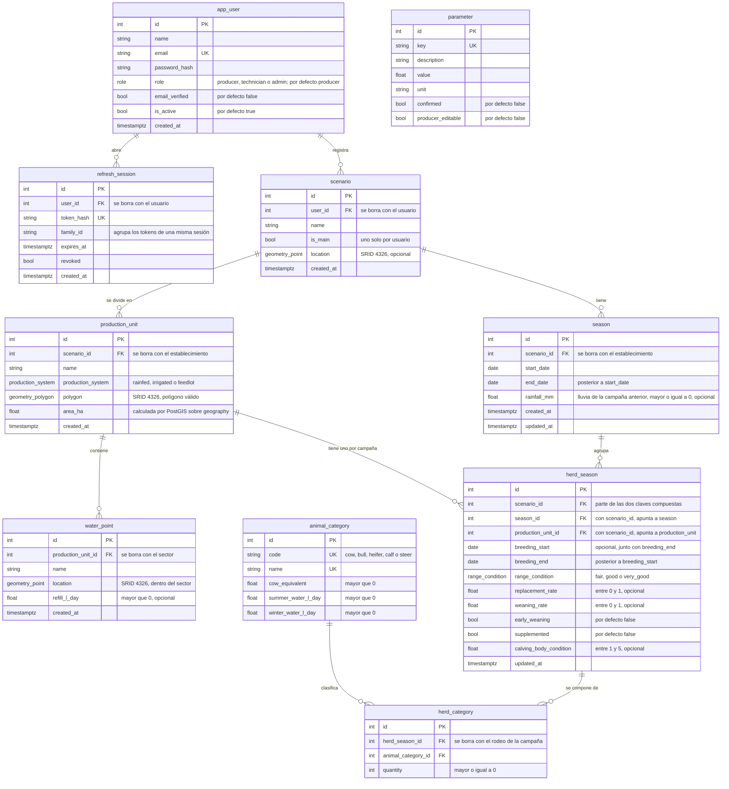

# Diagrama de la base de datos

Modelo de datos vigente, generado a partir de los modelos de `backend/app/models/`. Si se agrega o cambia una tabla, este diagrama se actualiza en el mismo pull request.

## Reglas que el diagrama no muestra

- **Un establecimiento principal por usuario:** índice único parcial `uq_scenario_main_per_user` sobre `user_id` cuando `is_main` es verdadero.
- **Campañas sin superposición:** dentro de un mismo establecimiento, dos campañas no pueden compartir días (`ex_season_no_overlap`, restricción de exclusión con GiST).
- **Rodeo de la campaña dentro del mismo establecimiento:** `herd_season` apunta a `season` y a `production_unit` con claves compuestas que incluyen `scenario_id`. Así la campaña y el sector siempre son del mismo establecimiento. Hay un solo rodeo por campaña y sector.
- **Una cantidad por categoría:** `herd_category` no repite la misma categoría dentro de un rodeo.
- **Superficie:** `area_ha` es una columna calculada y guardada (`ST_Area(polygon::geography) / 10000`). No se escribe a mano.
- **Borrado en cascada:** al borrar un usuario se borra todo lo suyo. Lo mismo pasa con un establecimiento, un sector, una campaña o un rodeo: arrastran lo que depende de ellos. Una categoría animal en uso no se puede borrar.
- **Tablas sueltas:** `parameter` no se relaciona con otras tablas. La consulta el motor de cálculo por su `key`.
